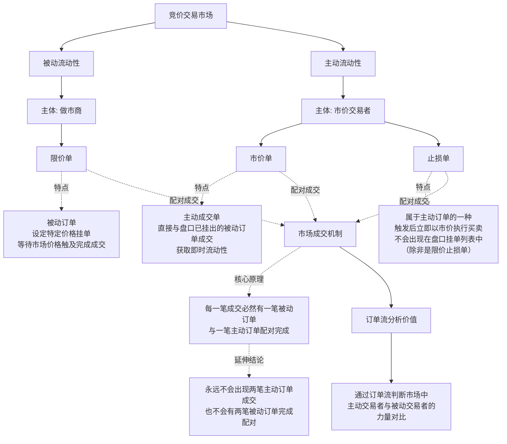

---
tags:
  - 股票
---
首先，市场中存在被动流动性与主动流动性。提供被动流动性的主体是做市商，主动获取流动性的主体是市价交易者。大家应该都知道，对应的是限价单与市价单两类订单。限价单也叫被动订单，即交易者设定特定价格挂单，等待市场价格触及该价位完成成交。而市价单也被称为主动成交单，因这类订单会直接与盘口已挂出的被动订单成交，获取即时流动性。能看到这里的观众想必都清楚限价单与市价单的区别。

市场中还有止损单，但止损单其实也是主动订单的一种。其触发逻辑为：当市场价格触及设定的触发价时，会在该价格点位立即以市价执行买入或卖出操作。因此止损单不会出现在盘口的挂单列表中，除非是限价止损单，否则无人能看到你的止损挂单。

这就是竞价交易市场的基本运行逻辑。市场中既有被动卖家，也有主动卖家，买家亦是如此，市场的价格波动正是由此产生。市场上的每一笔成交，必然有一笔被动订单与一笔主动订单配对完成。主动订单承接被动订单的流动性，一笔交易就此完成。这就是市场的成交机制。毕竟市场中永远不会出现两笔主动订单成交，也不会有两笔被动订单完成配对，这也是订单流有分析价值的原因所在——你能通过它判断市场中主动交易者与被动交易者的力量对比。

市场中有时是被动交易者占据主导，有时则是主动交易者的力量更胜一筹，价格的涨跌正是由这种力量对比决定。举个简单的例子：价格想要上涨，就必须有大量主动买单承接卖盘的流动性，也就是被动卖单的挂单。每一笔成交都是主动交易者的订单与被动交易者的挂单完成配对。

当市场中出现大量主动买单时，就会持续承接这些限价卖单。若主动买单的力量不足，无法承接该价位的所有被动卖单，价格便无法突破这一阻力位。如若此时没有新的主动买单进场，主动卖单就可能趁机占据主导，推动价格下跌。反之，若有足够多的主动买单承接所有被动卖单，价格就会继续上行，实现持续走高。同理，若该位置的主动买单力量不足，价格就可能出现回落；若买单力量充足，价格就会再次拉升。

<svg width="550" height="400" viewBox="0 0 800 400" xmlns="http://www.w3.org/2000/svg">
    <!-- 白色背景 -->
    <rect width="100%" height="100%" fill="#ffffff" />
    
    <!-- 坐标轴 -->
    <line x1="50" y1="40" x2="50" y2="360" stroke="#333" stroke-width="2"/>
    <line x1="50" y1="360" x2="750" y2="360" stroke="#333" stroke-width="2"/>
    
    <!-- 轴标签 -->
    <text x="10" y="360" fill="#333" font-size="14">价格</text>
    <text x="600" y="390" fill="#333" font-size="14">主动买量增加 →</text>
    <!-- 阻力位（被动卖单墙） -->
    <line x1="50" y1="220" x2="750" y2="220" stroke="#dc3545" stroke-width="2" stroke-dasharray="8,8"/>
    <text x="550" y="205" fill="#dc3545" font-size="15" font-weight="bold">阻力位（被动卖单墙）</text>
    <!-- 平滑曲线（模拟价格波动） -->
    <!-- C 代表三次贝塞尔曲线，可以画出平滑的波峰波谷 -->
    <path d="M 80 300 
             C 100 300, 120 220, 150 220 
             C 170 220, 180 300, 220 300 
             C 250 300, 270 220, 300 220 
             C 320 220, 340 280, 380 280 
             C 410 280, 420 220, 450 220 
             C 480 220, 490 150, 520 130 
             C 550 110, 600 80, 700 50" 
          fill="none" stroke="#007bff" stroke-width="4" stroke-linecap="round"/>
    <!-- 标注点与文字 -->
    <!-- 第一次冲击失败（买量不足） -->
    <circle cx="150" cy="220" r="5" fill="gray"/>
    <text x="150" y="190" fill="#666" font-size="13" text-anchor="middle">买量不足，无法承接</text>
    <text x="150" y="240" fill="#666" font-size="13" text-anchor="middle">卖单，价格回落</text>
    <!-- 第二次冲击失败（买量不足） -->
    <circle cx="300" cy="220" r="5" fill="gray"/>
    <text x="300" y="190" fill="#666" font-size="13" text-anchor="middle">再次遇阻，回落</text>
    <!-- 第三次冲击成功（大量买单进场，突破） -->
    <circle cx="450" cy="220" r="6" fill="green"/>
    <text x="420" y="180" fill="green" font-size="15" font-weight="bold">主动买单大量承接，突破</text>
    <!-- 持续拉升 -->
    <circle cx="700" cy="50" r="6" fill="green"/>
    <text x="620" y="30" fill="green" font-size="15" font-weight="bold">买量充足，持续拉升</text>
</svg>

价格下跌的逻辑亦是如此。假设盘口该位置有大量被动卖单，但主动买单的力量不足以推动价格突破上方阻力，此时大量主动卖单开始进场，且该价位的主动卖单数量超过被动买单数量，价格就会开始下跌，直至触及下方有大量被动买单的支撑位。若此时主动卖单的力量衰减，价格就可能出现反弹；但如果有足够多的主动卖单承接下方的被动买单，价格就会继续下跌，抵达下一个支撑位。

<svg width="550" height="500" viewBox="0 0 800 500" xmlns="http://www.w3.org/2000/svg">
    <!-- 白色背景 -->
    <rect width="100%" height="100%" fill="#ffffff" />
    
    <!-- 坐标轴 -->
    <line x1="50" y1="50" x2="50" y2="430" stroke="#333" stroke-width="2"/>
    <line x1="50" y1="430" x2="750" y2="430" stroke="#333" stroke-width="2"/>
    
    <!-- 轴标签 -->
    <text x="10" y="430" fill="#333" font-size="14">价格</text>
    <text x="600" y="460" fill="#333" font-size="14">时间 / 主动卖量增加 →</text>
    <!-- 上方阻力位（被动卖单墙） -->
    <line x1="50" y1="150" x2="750" y2="150" stroke="#dc3545" stroke-width="2" stroke-dasharray="8,8"/>
    <text x="580" y="140" fill="#dc3545" font-size="15" font-weight="bold">上方阻力位（被动卖单墙）</text>
    <!-- 下方支撑位（被动买单墙） -->
    <line x1="50" y1="350" x2="750" y2="350" stroke="#28a745" stroke-width="2" stroke-dasharray="8,8"/>
    <text x="580" y="340" fill="#28a745" font-size="15" font-weight="bold">下方支撑位（被动买单墙）</text>
    <!-- 价格曲线（模拟下跌、触底反弹、破位再跌） -->
    <!-- C 代表三次贝塞尔曲线，用来模拟平滑且带波动的下跌趋势 -->
    <path d="M 80 150 
             C 120 150, 150 100, 180 120 
             C 210 140, 230 200, 280 300 
             C 320 360, 360 350, 400 350 
             C 430 350, 460 250, 500 300 
             C 520 320, 560 400, 620 420
             C 660 430, 700 430, 730 430" 
          fill="none" stroke="#007bff" stroke-width="4" stroke-linecap="round"/>
    <!-- 标注点与文字 -->
    <!-- 1. 顶部遇阻 -->
    <circle cx="150" cy="120" r="6" fill="gray"/>
    <text x="130" y="100" fill="#666" font-size="14" text-anchor="middle">主动买单不足，无法突破</text>
    <!-- 2. 大量主动卖单进场，开始下跌 -->
    <circle cx="280" cy="300" r="6" fill="red"/>
    <text x="180" y="280" fill="red" font-size="15" font-weight="bold">大量主动卖单进场</text>
    <text x="180" y="300" fill="red" font-size="14">主动卖单超过被动买单，价格下跌</text>
    <!-- 3. 触及支撑位，反弹 -->
    <circle cx="400" cy="350" r="6" fill="green"/>
    <text x="370" y="370" fill="green" font-size="14">触及支撑位，被动买单抵抗</text>
    <text x="370" y="390" fill="green" font-size="14">主动卖单衰减，价格反弹</text>
    <!-- 4. 主动卖单承接支撑位，破位下跌 -->
    <circle cx="500" cy="300" r="6" fill="red"/>
    <text x="490" y="280" fill="red" font-size="15" font-weight="bold">主动卖单数量足够多</text>
    <text x="490" y="300" fill="red" font-size="14">吃掉下方被动买单，跌破支撑</text>
    <!-- 5. 到达下一个支撑位 -->
    <circle cx="620" cy="420" r="6" fill="red"/>
    <text x="620" y="440" fill="red" font-size="15" font-weight="bold">价格继续下跌</text>
    <text x="620" y="460" fill="red" font-size="14">抵达下一个支撑位</text>
</svg>

以上就是价格波动的基本逻辑，仅为简单举例说明。市场上的每一笔成交，永远是主动交易者与被动交易者的配对结果。因此，主动交易者与被动交易者的力量博弈，才是推动价格真正波动的核心。