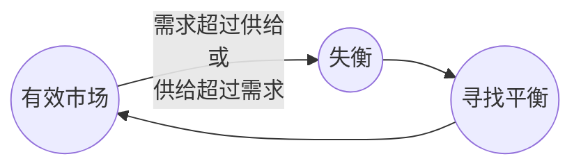

---
tags:
  - 股票
---

当市场有效时，这就是公平价值，这在成交量分布图上看起来会是这样，只是侧过来了。买卖双方再次对价格达成一致，任何一方都没有优势，这看起来就像是盘整。每当供应超过需求或需求超过供应时，我们就进入价格发现阶段，这就是所谓的失衡市场。

所以当我们处于失衡状态时，我们正在寻找平衡并寻求公平价值。

在下面这个价格图表上更能说明这一点。它看起来就像是盘整，所以我们正在盘整。你可以看到这属于公平价值。然后我们出现失衡，价格下跌，直到再次寻求公平价值，也就是价格将开始盘整的地方，再一次平衡。直到需求超过供给，这时又出现一次失衡，价格随后上涨，以再次发现公平价格。这正是市场运动的基本方式。

主要就是市场会保持平衡，直到失衡。一旦失衡，它就会寻求公平价值或重新建立平衡。平衡的市场意味着买卖双方对价格达成一致；每当市场变得不平衡时，这意味着买卖双方对价格存在分歧。比如买家说这太低了，我们要吃进，所以买方的失衡推动了价格上涨。

<svg width="550" height="450" viewBox="0 0 800 450" xmlns="http://www.w3.org/2000/svg">
    <!-- 背景 -->
    <rect width="100%" height="100%" fill="#f4f4f4" />
    <!-- 网格线 (模拟原图的方格纸背景) -->
    <defs>
        <pattern id="grid" width="20" height="20" patternUnits="userSpaceOnUse">
            <path d="M 20 0 L 0 0 0 20" fill="none" stroke="#e0e0e0" stroke-width="1"/>
        </pattern>
    </defs>
    <rect width="100%" height="100%" fill="url(#grid)" />
    <!-- 左侧平衡区 -->
    <rect x="80" y="100" width="200" height="60" fill="white" stroke="#333" stroke-width="2"/>
    <text x="130" y="90" fill="#333" font-size="16" font-weight="bold">Balance</text>
    <!-- 左侧波浪线 -->
    <polyline points="90,130 110,130 120,120 140,140 150,120 170,140 190,130 210,120 230,140 250,120 270,130" fill="none" stroke="#333" stroke-width="2" stroke-linejoin="round"/>
    <!-- 中间偏下平衡区 -->
    <rect x="320" y="300" width="200" height="60" fill="white" stroke="#333" stroke-width="2"/>
    <text x="370" y="290" fill="#333" font-size="16" font-weight="bold">Balance</text>
    <!-- 中间波浪线 -->
    <polyline points="330,330 350,320 370,340 380,320 400,340 420,320 440,330 460,320 480,340 500,330 510,320" fill="none" stroke="#333" stroke-width="2" stroke-linejoin="round"/>
    <!-- 右侧平衡区 -->
    <rect x="600" y="100" width="200" height="60" fill="white" stroke="#333" stroke-width="2"/>
    <text x="650" y="90" fill="#333" font-size="16" font-weight="bold">Balance</text>
    <!-- 右侧波浪线 -->
    <polyline points="610,130 630,120 650,140 670,120 690,130 710,120 730,140 750,130 770,120 790,140" fill="none" stroke="#333" stroke-width="2" stroke-linejoin="round"/>
    <!-- 连接线1：从左侧平衡区向下的失衡弧线 -->
    <path d="M 170 160 C 250 230, 300 230, 350 300" fill="none" stroke="#333" stroke-width="2"/>
    <text x="260" y="240" fill="#333" font-size="16" font-weight="bold" transform="rotate(-20 260 240)">Imbalance</text>
    <!-- 箭头 -->
    <polygon points="350,300 340,290 355,285" fill="#333"/>
    <!-- 连接线2：从中间平衡区向上的失衡弧线 -->
    <path d="M 480 300 C 550 220, 600 230, 670 160" fill="none" stroke="#333" stroke-width="2"/>
    <text x="580" y="240" fill="#333" font-size="16" font-weight="bold" transform="rotate(20 580 240)">Imbalance</text>
    <!-- 箭头 -->
    <polygon points="670,160 660,170 675,175" fill="#333"/>
</svg>